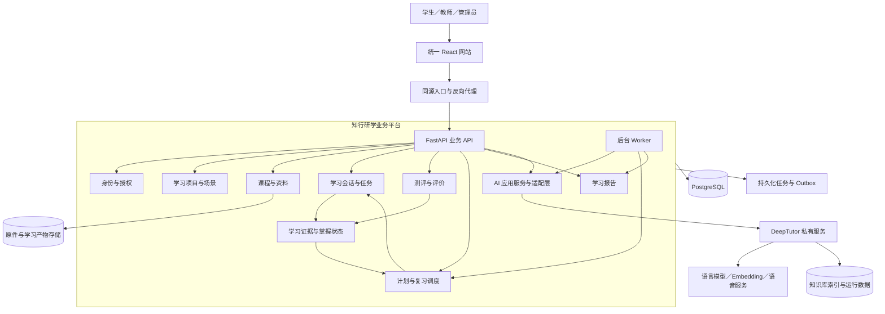
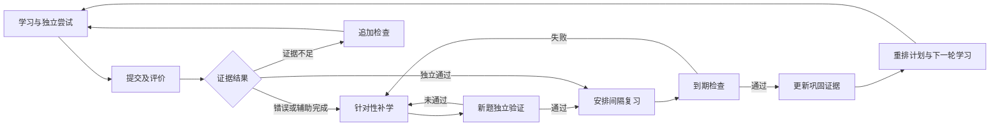

# 知行研学平台 V2.0 架构设计

版本：V2.0 设计基线  
日期：2026年11月5日  
依据：已确定的 V2.0 产品需求与架构方案  
状态：目标设计，待分阶段实施与验收

实施进展：已落地的核心功能、实际验收及尚未完成项目以 [V2 实现与验收](v2-implementation.md) 为准，本文仍保留完整目标架构。

## 1. 架构目标与总体结构

平台采用 **React 前端 + FastAPI 模块化单体 + 独立后台 Worker + DeepTutor 基础服务**。

平台负责学习业务和可信记录，DeepTutor 负责 AI 教学执行。围绕学习证据形成循环：

**学习目标 → 计划 → 学习与练习 → 评价 → 补学与验证 → 间隔复习 → 更新计划。**

首版实现考研政治完整闭环；章节学习、期末备考通过场景策略扩展。保留历史资料、作答和成绩，不延续现有页面结构。

本文是 V2 重构的目标基线，不是实施完成报告。当前系统仍以代码、[教师资料与 Agent 流程](teacher-agent-architecture.md)和对应验收记录为准；[V1 历史架构](architecture.md)保留用于理解旧数据和迁移背景。后续阶段完成时，应分别更新验收记录，而不是提前将本设计标为已实现。

### 1.1 技术决策

| 层次 | 采用方案 |
|---|---|
| 前端 | 延续 React、TypeScript、Vite、React Router、TanStack Query；按业务模块重组 |
| 业务后端 | FastAPI、Pydantic、SQLAlchemy、Alembic，采用模块化单体 |
| 主数据库 | V2.0 联调及交付使用 PostgreSQL；旧 SQLite 仅作为迁移来源 |
| 后台执行 | 数据库任务队列、独立 Worker、任务租约与幂等处理 |
| 文件存储 | 首版本地持久化目录，通过 FileStore 接口访问 |
| AI 基础服务 | 固定版本及镜像摘要的 DeepTutor，通过内部网络访问 |
| 前端通信 | REST 处理业务操作；SSE 推送 AI 和生成任务进度 |
| 内部 AI 通信 | 适配 DeepTutor REST 与 `/ws` 协议 |
| 初期基础设施 | 不引入 Redis、独立消息队列或业务微服务 |

### 1.2 产品与架构边界

- 以自主学习为主，兼容教师课程、作业、批阅和辅导；个人学习不以加入机构或班级为前置条件。
- 学生端围绕今日学习、学习项目、练习与模考、资料与笔记、学习报告组织。前台显示用户任务，不暴露 DeepTutor 工具名称作为主导航。
- 平台课程与个人资料并存；个人资料和学习产物默认私有，不自动进入公共课程或公共题库。
- 首版仅交付考研政治完整流程。其他独立场景和学科属于后续扩展，不通过空页面冒充可用能力。

## 2. 业务模块与学习闭环

### 2.1 模块职责

| 模块 | 负责内容 | 明确边界 |
|---|---|---|
| 身份与授权 | 用户、个人空间、机构、班级、角色、资源访问 | 其他模块不得自行推导权限 |
| 学习项目与场景 | 场景、科目、目标、考试日期、时间预算、资料范围 | 场景影响策略，不复制整套学习系统 |
| 课程与资料 | 考纲、章节、知识点、原件、版本、题库、内容发布 | 检索索引不能决定内容发布状态 |
| 学习计划 | 阶段安排、今日任务、任务优先级、计划调整 | 模型建议不能直接覆盖生效计划 |
| 学习执行 | 阅读、讲解、练习、笔记、会话恢复 | 学习完成不等于知识掌握 |
| 测评与评价 | 组卷、模考、作答、规则判分、AI 训练评价、教师评分 | 三类评价分别保存 |
| 证据与掌握 | 归集学习证据、计算知识点状态、解释状态变化 | 不直接使用 DeepTutor 记忆作为掌握依据 |
| 补学与复习 | 错因建议、补学包、新题验证、到期复习 | 原题重做不充当新题验证 |
| 笔记与学习产物 | 笔记、闪卡、收藏、来源关联 | 自评记忆卡与测验成绩分开 |
| 教学协同 | 教师课程、作业、批阅、帮助和复核 | 默认不读取学生私有资料 |
| AI 应用服务 | 组织调用、授权上下文、输出校验、引用、用量 | 不拥有成绩、权限和学习状态 |
| 报告与运行管理 | 学习统计、任务状态、审计、服务健康 | 报告从业务事实派生，可重新计算 |

模块通过应用服务协作，不跨模块直接修改对方拥有的数据。API 层处理身份上下文、输入和响应；应用服务拥有事务；策略与评分规则不依赖 HTTP 或模型；基础设施负责数据库、文件与外部服务。

### 2.2 场景策略

使用同一套学习项目、任务、会话和证据模型，通过场景策略决定计划与报告。

| 场景 | 策略重点 | 交付阶段 |
|---|---|---|
| 考研复习 | 年度范围、阶段复习、真题、综合模考、长期巩固 | 首版 |
| 章节学习 | 指定章节、前置知识、局部掌握与迁移应用 | 后续独立场景 |
| 期末备考 | 明确截止日期、考试范围、重点与短期查漏 | 后续独立场景 |

首版考研项目允许开展章节学习活动，但不因此宣称独立章节场景已经交付。

学习项目引用一个场景策略版本和课程范围版本。调整目标、截止日期或范围产生新的计划版本，不修改历史安排。用户确认首份计划和实质性范围变更；日常调度在已确认范围和时间预算内自动进行。

基础诊断允许跳过。没有检查证据的知识点保留未知状态，通过后续学习逐步建立证据，不阻断自主学习。

### 2.3 学习状态与调度

将以下三类状态分开管理：

| 对象 | 状态示例 |
|---|---|
| 学习任务 | 待开始、进行中、完成、暂缓、取消 |
| 知识点掌握 | 待了解、学习中、待验证、已验证、待复习 |
| AI 执行 | 排队、运行、等待用户、成功、失败、取消 |

知识点掌握规则由平台策略执行：

- 阅读、查看解析和使用提示只产生过程证据。
- 无提示完成符合要求的新题，产生独立验证证据。
- 到期复习成功，产生延迟巩固证据。
- 答错、辅助完成和自评“不熟悉”，分别影响对应后续任务。
- AI 评价必须保存依据及来源身份；教师正式评价单独参与正式成绩。
- 同一知识点在不同年度、课程范围和学习项目中的证据，只有显式映射后才能复用。
- 低信心答对保留正确结果和信心记录，并追加检查任务；不按答错计分。
- 学生可以暂缓和跳过，系统保留范围缺口与原因，不自动声明掌握。

首版复习保留可配置、带版本的 1／3／7 天策略。提前练习不自动消除尚未发生的延迟检查；复习失败创建补学任务，通过验证后重新计算后续安排。

计划服务综合到期复习、薄弱点、新学习和教师截止任务，按每日时间预算安排。任务使用稳定业务键去重；重排更新未完成任务的安排，不复制历史任务。预算不足时显示延期和范围缺口，不无限累加今日任务。

### 2.4 一次提交如何闭合循环

1. 平台验证身份、任务模式及题目版本，冻结本次作答。
2. 客观题同步判分；分析题创建 AI 训练评价或教师批阅任务。
3. 保存作答、评价、证据变化和后续处理事件。
4. 对可确定结果，同步生成下一步任务；AI 评价完成后再次进入同一业务处理入口。
5. 答错进入补学，独立通过进入复习安排，样本不足进入待验证。
6. 今日计划立即展示新的可执行任务；报告异步更新。

关键写入在业务事务中完成。模型调用、文档解析和网络请求在事务之外执行。

### 2.5 评价与年度内容

训练模式允许用户主动请求提示；模考模式整卷提交前禁止平台提供解题帮助。客观题按固定题目及评分策略版本判分。

自主分析题由 AI 提供训练估分、要点覆盖和改进建议，驱动补练，持续标明“AI 训练评价”；教师作业的正式成绩由教师确认。教师改分保留修订历史，并触发证据与后续任务重新核对，不覆盖原始作答。

政治课程按适用年度和资料范围版本组织。真题、模拟题、仿题与 AI 生成题区分身份，保留出处。时政与教材更新创建新版本；历史作答继续关联旧版本。少量样本不用于生成全科预测分数。

## 3. 数据架构、API 与 DeepTutor 集成

### 3.1 数据事实与归属

**PostgreSQL 是业务事实来源。**

DeepTutor 索引、模型摘要、运行检查点和前端缓存不作为正式业务记录的唯一来源。

| 数据组 | 核心对象 |
|---|---|
| 身份空间 | User、PersonalSpace、Organization、Membership、Class、ResourceGrant |
| 学习项目 | LearningProject、ProjectScope、ScenarioPolicyVersion |
| 课程内容 | CurriculumVersion、Chapter、KnowledgePoint、SourceVersion、QuestionVersion |
| 计划执行 | PlanVersion、LearningTask、StudySession、SessionCheckpoint |
| 测评评价 | ExamSession、Attempt、RuleEvaluation、TrainingEvaluation、OfficialEvaluation |
| 学习闭环 | LearningEvidence、MasteryProjection、Remediation、Verification、ReviewSchedule |
| 学习产物 | Note、Flashcard、Artifact、SourceReference |
| AI 集成 | AIRun、AIEvent、ServiceResourceMapping、UsageRecord |
| 运行保障 | Job、OutboxEvent、IdempotencyRecord、AuditEvent |

上述名称表达逻辑对象；落库通过 Alembic 增量迁移完成，不能把现有同义数据未经映射地复制成另一套事实。

个人空间独立于机构成员关系。自主学习不要求加入教师班级；机构资源仍通过机构成员和班级授权访问。所有资源明确拥有者、空间及可访问范围；客户端不得自行选择他人身份或机构上下文。

原件由平台保存，DeepTutor 持有用于解析或检索的派生副本。引用保存平台资料版本、来源定位及服务资源映射；无法核对的位置显示“未验证引用”，不能伪装成可定位原文。

笔记、闪卡及已接受的讲解产物保存到平台；不依赖 DeepTutor 会话永久存在才能访问。学生主动共享后教师才能访问相应个人内容。

原始证据不可覆盖；掌握状态和报告是带策略版本的派生结果，可按有效证据重算。课程发布、计划、题目、评分和评价修订保留版本。数据库保存 UTC 时间，界面以 Asia/Shanghai 展示；跨日调度使用项目时区。

### 3.2 对外 API

新增业务统一使用 `/api/v2`，旧 `/api/v1` 在迁移期间保留。前端不直接调用 DeepTutor。

| 接口组（相对于 `/api/v2`） | 主要用途 |
|---|---|
| `/learning-projects` | 创建项目、选择场景、管理范围与归档 |
| `/learning-projects/{id}/plans` | 查看计划版本、调整预算、确认计划变更 |
| `/today` | 聚合今日任务、到期复习和继续学习入口 |
| `/study-sessions` | 开始、恢复、完成一次学习 |
| `/assessments` | 创建训练或模考、保存答案、整组提交 |
| `/remediations`、`/reviews` | 补学、验证与复习 |
| `/materials`、`/notes`、`/flashcards` | 资料和学习产物 |
| `/learning-projects/{id}/report` | 范围覆盖、证据和阶段表现 |
| `/ai-runs` | 创建教学调用、查询状态、取消及重试 |
| `/ai-runs/{id}/events` | SSE 订阅进度及恢复事件 |

统一约定：

- 业务创建返回资源 ID；异步操作返回 `202` 和任务查询地址。
- 提交、发布、生成和重试使用幂等键；相同键不同请求内容返回冲突。
- 草稿及人工编辑使用修订号，冲突返回 `409`。
- SSE 事件携带运行 ID 和递增序号，支持断线续读；事件先持久化后交付，重新订阅不重新执行模型。
- 普通进度查询作为流式连接失败时的恢复途径。
- 用户刷新或退出页面不取消后台任务；取消通过独立命令执行。退出登录后不能继续接收受保护事件。
- 登录沿用服务端会话与同源 Cookie；写操作校验 CSRF，SSE 订阅检查会话及运行归属，不在 URL 中传递长期凭据。
- 接口实现后同步生成 OpenAPI 和前端类型；本节接口组为设计，不代表当前 OpenAPI 已包含这些接口。

### 3.3 DeepTutor 适配层

定义平台内部 `TutorService` 接口，覆盖：

- 服务能力与依赖就绪检查。
- 资料同步、索引状态和引用解析。
- 创建教学运行、订阅事件、提交澄清回答、取消及恢复。
- 资源撤权和删除同步。
- 用量、错误及生成产物转换。

平台通过以下步骤调用：

`业务请求 → 授权与模式检查 → 构造教学上下文 → DeepTutor 执行 → 校验引用和结果 → 保存平台产物或建议`

教学上下文包括项目、资料版本、知识点、会话、训练模式及帮助限制。平台接口接受的是用户任务，不允许客户端任意传入工具白名单或外部工作区 ID。

首版启用资料答疑、精读、解题、辅助出题和可视化。音视频、数学动画、外部 Agent 等能力后置。DeepTutor 的 Mastery Path 可辅助设计教学路径，但平台独立维护掌握状态和复习调度。

现有 LangGraph 业务生成流程在能力切换后退役相应模型执行节点，不与 DeepTutor 双重执行；保留历史检查点和历史运行记录。按能力切换单一执行后端，不能在结果不明时自动调用另一个后端重复生成。

资料经平台保存、授权和版本确认后同步到 DeepTutor，平台记录下游解析与索引就绪状态。新增题目先完成结构、题型、答案、来源及重复校验；公共题目继续走内容治理，个人题保持私有。文本引用通过平台来源定位核对，不以模型自报页码作为验证结果。

### 3.4 身份与资料隔离

当前本机单用户 DeepTutor 实例不能直接承担多人集成。

集成版启用 DeepTutor 多用户隔离，并新增受信任的内部身份交换适配：

- 平台签发短时、仅供内部交换使用的身份断言。
- 适配组件校验签名和有效期，将身份映射到 DeepTutor 原生用户作用域。
- 下游使用原生授权上下文；不直接把客户端字段或平台登录 Cookie 当作 DeepTutor 身份。
- 身份交换能力属于待开发集成扩展，不假定官方已有接口。扩展限制在身份边界，维护独立补丁与兼容性测试。

资源映射包含平台用户、空间、项目、授权范围版本及下游工作区。首次采用授权范围变化即创建新执行作用域的策略，旧会话不在权限变化后继续执行。

调用开始、恢复和结果交付均检查当前权限。撤权后禁止恢复旧运行、读取旧产物或获取原文；索引清理通过后台任务完成，期间禁止访问相关执行作用域。平台保留必要历史记录，但读取仍受当前权限约束。

模考中，服务端拒绝针对当前试卷的解题请求，并暂停项目内可泄露答案的助教会话。该限制覆盖平台提供的入口，不声称能够阻止用户在外部网站获取帮助。

## 4. 运行、故障恢复与安全

### 4.1 部署结构

首版部署单元为：

- 反向代理及静态前端。
- 业务 API。
- 后台 Worker。
- PostgreSQL。
- 集成版 DeepTutor 服务及其持久化存储。

仅网站入口对用户开放。数据库、DeepTutor 及身份交换接口处于内部网络。开发管理入口仅允许本机访问。当前 DeepTutor 试用实例保留为独立环境；集成环境单独配置身份、数据目录及网络，不能直接暴露试用实例。

### 4.2 后台任务

数据库 Job 队列采用至少一次执行、原子领取、租约续期及超时恢复。任务区分交互教学、资料处理和批量生成，采用独立并发配额，避免大批量任务阻塞答疑。

网络状态不明时优先查询已有 DeepTutor 运行并恢复订阅；只有确认没有创建运行后才重新创建。无法消除外部重复计费的情况记录并提示，不承诺跨系统恰好一次执行。

业务结果通过唯一键和幂等写入去重。Outbox 事件与业务事实同事务保存，消费者处理成功后确认。取消请求需要等待执行确认，不能仅因客户端点击取消就将下游标为已停止。

### 4.3 故障行为

| 故障 | 平台行为 |
|---|---|
| DeepTutor 或模型不可用 | 保留作答，提供已有原文、解析和非 AI 任务 |
| 资料索引未就绪 | 暂停依赖该索引的生成；允许查看已解析原文 |
| 生成题未通过校验 | 不进入可用题库，显示原因并允许有限重试 |
| 引用无法匹配 | 降级为未验证内容，不作为掌握或正式评分依据 |
| AI 分析题评价失败 | 保留待评价状态，安排其他学习任务 |
| Worker 中断 | 租约到期恢复，不重复提交学习结果 |
| 流式连接断开 | 学习页面按事件序号恢复，已有内容不丢失 |
| 学习计划积压 | 按预算重新排序，展示延期和范围缺口 |

资料不足不以模型记忆伪造出处；解析失败不显示空白“成功”状态；不通过演示题或固定答案掩盖真实服务失败。

### 4.4 安全与观测

模型密钥仅保存在服务端。初期关闭非必要的代码执行、任意 CLI、外部 Agent 和不受控 MCP；所需生成内容在独立、受限的预览环境中展示。生成 HTML 使用沙箱隔离，不允许访问平台登录态或任意脚本权限。

原件和笔记备份以平台版本为基线；DeepTutor 数据使用独立备份清单。恢复后核对业务资源映射和索引版本，缺失索引可重建。备份记录平台与服务版本、数据库及文件摘要、任务检查点和备份时间边界。

日志贯通请求、项目、任务及 AI 运行 ID，不记录密钥和默认完整私有正文。监控业务提交延迟、队列等待、AI 成功率、引用校验失败率、用量与学习闭环完成情况。健康检查区分业务可用性和 AI 能力可用性。

DeepTutor 升级先在隔离环境验证接口、身份隔离、事件恢复、引用与资源映射，再更新固定镜像摘要；不能直接跟随 `latest` 升级集成环境。

## 5. 迁移、验证与实施顺序

### 5.1 数据迁移

1. 盘点旧 SQLite 数据、文件和检查点，形成只读备份。
2. 使用 Alembic 建立 PostgreSQL 新结构。
3. 导入账号、组织关系、资料版本、题目、作答和评价，保留原 ID。
4. 将旧目标及学习记录归入“历史学习项目”，保留来源标识。
5. 无法可靠推导的知识点状态保留未知；不补造掌握证据。
6. 比对记录数量、文件摘要、版本关联及评分历史。
7. 演练通过后，维护窗口停止旧写入，执行最终迁移并切换。

旧库保留只读。开放新版本写入前可以直接回切；开放后若需回切，必须先保全新增数据并执行补偿迁移，不能直接恢复旧备份覆盖。

旧 SQLite 的业务数据和历史 LangGraph 检查点分别迁移或归档；归档检查点不作为新版继续执行的默认入口。V2 上线后不再双写新旧数据库。

### 5.2 验证范围

| 验证项 | 核心验收要求 |
|---|---|
| 学习状态与调度 | 确定性验证证据、提示、低信心、新题验证、1／3／7 天复习及计划重排 |
| PostgreSQL | 并发提交、任务领取、租约、幂等与事务一致性通过测试 |
| DeepTutor 契约 | 协议、身份映射、索引状态、澄清回答、取消与运行恢复通过测试 |
| 权限隔离 | 两用户、两机构、撤权及历史会话恢复不能越权 |
| 浏览器闭环 | 资料学习—练习—补学—新题验证—延迟复习完整执行 |
| 测评 | 模考限制、训练评价与正式评分分离，评分修订有历史 |
| 真实模型 | 人工抽查实际生成内容、题目答案、评价依据及引用 |
| 运行恢复 | 迁移、备份恢复、服务中断及 Worker 崩溃演练通过 |

复习验收使用可控时钟，不要求真实等待七天；完整学习旅程覆盖桌面和手机布局。真实模型质量抽查与受控适配器测试分别记录，不能互相替代。

### 5.3 实施阶段

| 阶段 | 实施内容 | 阶段完成条件 |
|---|---|---|
| 1. 建立底座 | PostgreSQL、模块边界、个人空间、DeepTutor 身份及资源适配 | 身份隔离、资料映射和基础协议契约通过 |
| 2. 打通单次闭环 | 项目创建、资料学习、训练反馈、补学与新题验证 | 无教师实时参与也能完整执行一次闭环 |
| 3. 打通跨日闭环 | 复习调度、今日计划、证据状态与阶段报告 | 到期检查、失败回流、预算重排及报告一致性通过 |
| 4. 完善考研政治 | 真题、模考、分析题训练及教师协同 | 年度内容、模式限制与评价边界通过验收 |
| 5. 迁移并切换 | 历史数据核对、真实服务验收、维护窗口切换 | 迁移与恢复演练通过，历史及新增学习链可追溯 |

架构完成标准是：**平台独立掌握学习事实和调度，DeepTutor 可被替换；学生在没有教师实时参与时，也能持续完成学习、验证与复习循环。**

## 6. 依据与关联文档

- 本文依据本次确认的 V2.0 需求及架构方案；若独立需求文档后续落库，应与本文同步维护需求到模块和验收的对应关系。
- [V1 历史架构](architecture.md)：旧设计与数据迁移背景。
- [既有架构决策](adr/0001-modular-monolith.md)：沿用模块化单体原则；其 SQLite 与旧 AI 编排选择由本文 V2 目标决策更新。
- [教师资料与 Agent 流程](teacher-agent-architecture.md)：现有教学与评分链路，迁移时保留其有效历史语义。
- [运行维护](operations.md)：当前运行方式；V2 部署完成后再补充新的启动、备份和恢复操作。
- [DeepTutor 官方服务 API](https://docs.deeptutor.info/cli/server-api/)：官方接口参考，实际集成以固定版本的契约测试为准。

本文不改变当前运行配置，不执行数据库迁移，也不将待开发身份交换扩展或 V2 接口描述为官方现成能力。
