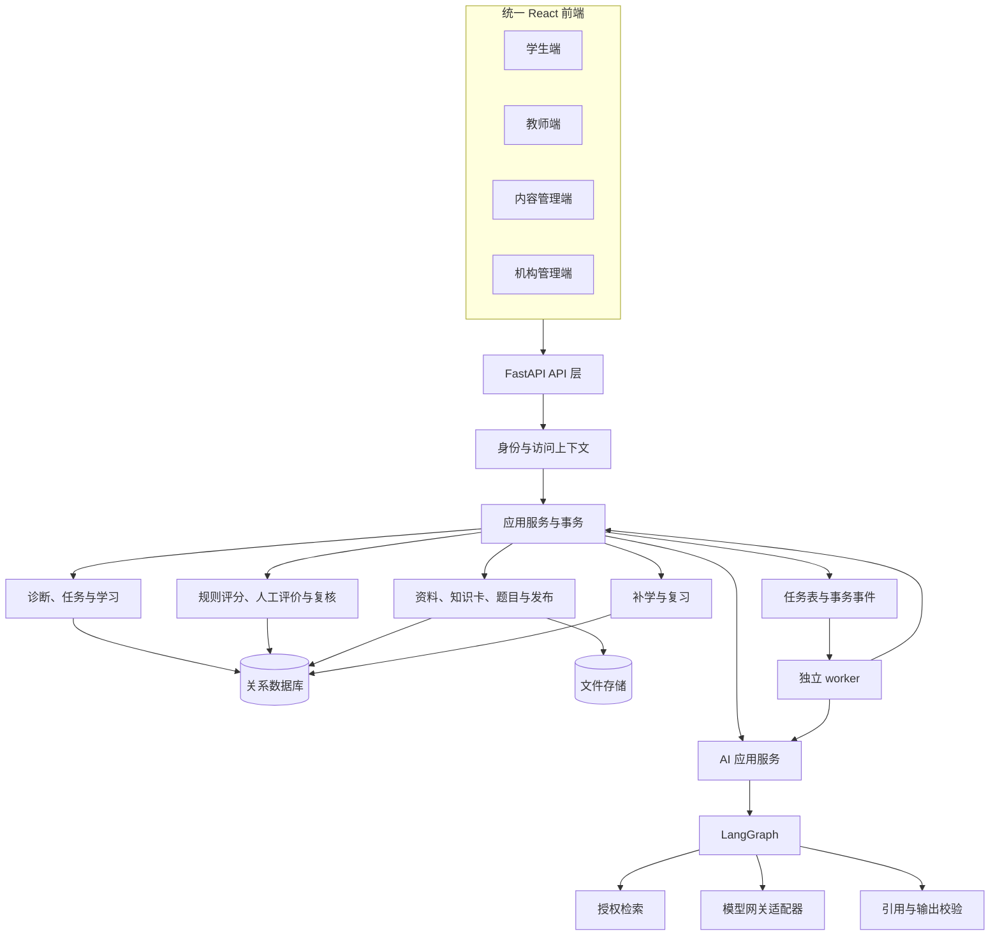
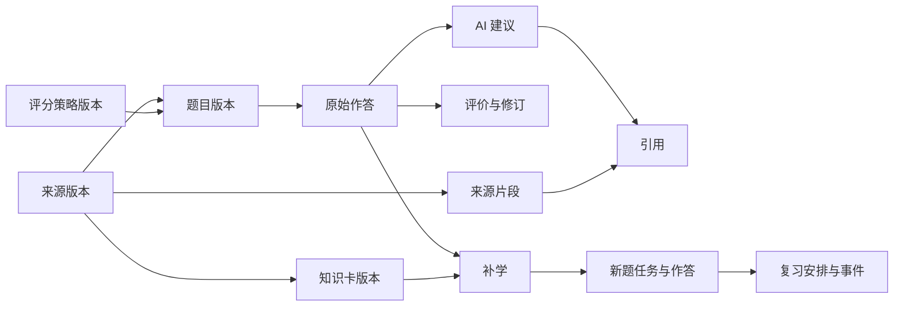

# 知行研学平台总体架构设计

版本：V1.1　日期：2026-10-27　状态：总体设计与首版实施基线

> 版本关系（2026-11-05）：本文作为 V1 历史设计保留。V2 重构以 [V2.0 架构设计](architecture-v2.md) 为目标基线；其中 PostgreSQL、学习项目与 DeepTutor 集成等为待实施设计，不能据此判断当前系统已经支持。当前运行行为以流程说明、代码及验收记录为准。

2026-10-29流程更新：当前入口采用“教师资料→Agent生成→班级作业→手动错题诊断→针对性练习”，详见[教师Agent架构](teacher-agent-architecture.md)。下文目标、基础诊断、逐题审核描述作为旧版基线保留，不再代表当前主流程。

## 1 文档定位

知行研学是面向考研学习与教学管理、需要长期维护的平台。总体架构覆盖多科目、多机构、内容治理、学习过程、评价复核、AI 辅助与运行维护。考研政治首版是本架构的第一个实施阶段，不是一次性原型。

本设计依据工作区中的《知行研学考研平台整体技术路线.docx》，并采纳项目讨论中的调整：首个科目改为政治，覆盖六个模块的少量原创示例，支持单选、多选和人工评分分析题，模型未配置时基础业务仍可运行。

| 层次 | 定义 | 约束 |
| --- | --- | --- |
| 总体架构 | 稳定的业务边界、数据语义、权限、版本和接口 | 后续功能遵守，不因首版范围而删减关键约束 |
| 首版实施 | 当前实际运行的模块和基础设施 | 以三条完整业务闭环验收 |
| 后续演进 | 组件替换和能力扩展的条件、路径 | 依据实际负载、内容和维护需求实施 |

长期目标是业务可扩展、证据可信、权限可治理、AI 可替换、系统可维护和交付可渐进。首版功能可以少，但原始作答、权限隔离、内容版本、数据库迁移和测试必须从开始建立。

## 2 架构原则

1. 原始答案、过程、提示和阅读事件是学习证据，派生统计可以重算，不能覆盖证据。
2. 正式成绩与 AI 建议分开保存；模型不能写成绩、权限、答案或发布状态。
3. 内容逻辑身份与版本分离；发布版本冻结，修订创建新版本。
4. 科目、模块、知识点和课程范围通过标识关联，核心模型不写死政治枚举。
5. 数据库是业务事实来源；检索索引与缓存均可重建。
6. 模块通过应用服务协作；事务归属明确，不使用全局事件溯源架构。
7. 优先模块化单体，不因未来可能扩容提前建设微服务。
8. 基础设施通过必要接口隔离，不为简单操作创建重复抽象。

## 3 总体架构

### 3.1 技术基线

| 层次 | 首版选择 | 长期约束 |
| --- | --- | --- |
| 前端 | React、TypeScript、Vite、React Router、TanStack Query、Ant Design | 功能分组；接口类型生成；页面不决定权限和成绩 |
| 后端 | Python 3.12、FastAPI、Pydantic | 路由负责协议，应用服务负责用例与事务 |
| 数据访问 | SQLAlchemy 2.x、Alembic | 迁移管理结构，数据库落实外键和唯一约束 |
| 数据库 | SQLite、WAL、外键和 busy timeout | 仅本地与受控演示；持续多人试用前迁移 PostgreSQL |
| 文件 | 本地 FileStore 适配器 | 业务引用不依赖物理路径，可切换对象存储 |
| 检索 | 中文关键词与知识点匹配 | 授权先于召回；不将关键词检索称为语义检索 |
| AI | LangGraph、兼容 OpenAI 协议的网关 | 检查点与正式业务记录分离；供应商可替换 |
| 任务 | 数据库任务表、独立进程 | 至少一次执行，最终写入幂等 |
| 测试 | pytest、Playwright | 独立数据库与演示数据分离 |

运行依赖锁定在 backend/requirements.txt 与 frontend/package-lock.json，不使用全局安装包作为交付依赖。

### 3.2 分层与目录

- 展示层：frontend/src 按学生、教师、内容功能组织；通用请求与状态反馈独立。
- API 层：backend/app/routes_* 负责输入模型、身份、协议与响应。
- 应用服务：learning.py、content.py、ai.py 控制学习、内容与 AI 用例。
- 规则：scoring.py 提供不依赖 HTTP、数据库或模型的评分策略。
- 基础设施：db.py、ports.py、worker.py 管理存储与执行。
- 模型：首版集中在 models.py，迁移保存在 backend/migrations。领域扩展后可按拥有权拆包，不改变对外契约。

首版的评价服务函数与学习服务放在同一文件，但写入入口统一由 score_essay 管理；不在路由和模型工作流中复制评分逻辑。

## 4 领域职责

| 领域 | 长期责任 | 首版实现 |
| --- | --- | --- |
| 身份组织 | 全局身份、机构成员、角色、班级与会话 | 学生、教师、管理员，服务端会话 |
| 学科课程 | 科目、模块、知识点、前置关系和课程版本 | 政治分类、示例知识点及课程范围 |
| 内容治理 | 原件、授权、核对、审核、发布和撤回 | Markdown/TXT、版本原文、知识卡与题目 |
| 题库测评 | 题型、答案、评分策略版本、诊断 | 单选、多选、分析题 |
| 学习计划 | 目标、诊断线索、任务优先级、进度 | 今日任务、时间预算、安排原因 |
| 评价复核 | 规则评价、教师评分、异议和修订 | 分项人工评分、乐观并发、历史保留 |
| 补学复习 | 错因、补学内容、新题、复习策略 | 确认错因、阅读、新题验证、1/3/7 天复习 |
| AI 检索 | 授权依据、提示、解释、候选错因与评测 | 真正来源检索、递进提示、可选模型调用 |
| 运维 | 任务恢复、审计、配置、备份、持续检查 | 独立 worker、健康检查、运行与恢复脚本 |

题库拥有题目与评分规则，学习服务引用具体版本；评价服务拥有正式成绩，AI 只产生建议；内容服务拥有发布状态，检索不能发布资料。统计使用只读聚合，不借统计接口修改源数据。

## 5 数据架构

### 5.1 身份模型

User 是全局身份，通过 Membership 加入 Organization；RoleAssignment 按机构或班级授权；ClassMember 记录教学关系；LoginSession 关联本次登录的机构成员关系。

用户可以拥有多个机构成员关系；登录时必须确定机构，不能自动把各机构的资料合并检索。首版只提供一个演示机构的界面，模型及登录接口已经保留机构上下文。

### 5.2 核心模型

| 模型组 | 实体 | 关键关联 |
| --- | --- | --- |
| 身份 | User、Organization、Membership、RoleAssignment、TeachingClass、ClassMember、LoginSession | 用户与机构、班级、权限和会话 |
| 学科 | Subject、Module、KnowledgePoint、Prerequisite | 科目不写死在业务逻辑中 |
| 课程 | Curriculum、CurriculumVersion | 适用年份、知识点范围及版本 |
| 来源 | Source、SourceVersion、SourceChunk、ContentReview | 来源授权、文件摘要、正文、章节与段落 |
| 题卡 | CardVersion、QuestionVersion、ScoringPolicyVersion | 稳定 card_id/question_id + 版本号；固定来源与规则版本 |
| 学习 | Goal、DiagnosticSession、LearningTask、Attempt、LearningEvent | 诊断题快照、任务原因、原始作答与提示 |
| 评价 | Evaluation、EvaluationRevision、ReviewCase | 当前有效修订、历史评分及异议 |
| 复习 | Remediation、ReviewSchedule | 原始错题、卡片版本、验证题、策略与到期时间 |
| AI | WorkflowRun、Citation | 提示模板、模型、结果、实际来源片段 |
| 平台 | Job、OutboxEvent、IdempotencyRecord、AuditEvent | 执行恢复、可靠事件、请求去重与审计 |

首版诊断题目快照以 LearningTask.diagnostic_id 表达；知识卡和题目逻辑身份直接保存在版本记录的 card_id、question_id 中；无需为没有独立属性的逻辑身份额外建空表。

### 5.3 约束与版本

- UUID 主键，UTC ISO 8601 时间，界面按 Asia/Shanghai 展示，整数分数。
- 唯一约束覆盖机构成员、内容版本、同任务作答、评价修订、复习阶段和幂等键。
- 草稿并发修改使用 revision；评价使用 expected_revision，过期修改返回 409。
- 已提交答案不可覆盖，重做产生新任务与新作答。
- 已发布正文、知识卡、答案、解析和规则不可原地修改；创建修订版本。
- 新任务与普通检索使用当前发布版本，既有任务和反馈固定原版本。
- 撤回禁止新使用；历史记录保留撤回说明。访问历史原文仍执行当前授权检查。
- 机构归属由服务端推导，不能通过客户端字段选择他人归属。

## 6 业务流程

### 6.1 目标、诊断与计划

保存科目、考试年份、目标分数和每日分钟数。诊断从各模块选择已发布代表题，固定题目版本；期间不返回答案、评价分数、解析、提示或资料检索结果。全部提交后统一结束诊断，再生成安排。

未覆盖知识点保持待诊断；少量样本不产生全科预测分数。首版不实现全国考试大纲映射。

计划按到期复习、新题验证、基础练习排序，并按每日时间预算展示。补学入口保留错因与阅读步骤，不把尚未阅读视为完成。题量不足明确显示缺口。

### 6.2 作答与评分

作答状态：draft → submitted → graded / pending_teacher。提交时冻结答案、过程、用时和提示等级。

- 单选：完全匹配得分。
- 多选：集合完全匹配得分，多选、漏选和错选不得分。
- 分析题：提交后待教师按 rubric 分项评分，未评不产生正式分数。
- 策略以名称和版本注册，题目引用 ScoringPolicyVersion，不执行上传代码。
- AI 建议独立保存，不能成为正式成绩。

教师修订和异议复核生成 EvaluationRevision，原记录不覆盖。统计使用最新有效修订；评分修订重新核对后续安排并保留既有事件。

### 6.3 补学与复习

流程：错误或辅助完成 → 候选错因 → 学生确认 → 对应知识卡 → 阅读记录 → 未使用的审核新题 → 独立作答 → 复习。

错因分类为概念混淆、原理适用错误、材料理解偏差、选项辨析错误、论证表达不足、审题或时间管理。不能仅凭最终答案确认全部深层原因。

阅读、提示、原题重做、新题独立完成分别记录。找不到新题时显示待补充，不复用原题冒充新题。

首版复习以独立通过时间为锚点，第 1、3、7 天逐阶段安排。每条安排保存策略版本，改变算法不静默修改既有任务。答错或有提示完成回到补学，未评分分析题不判定掌握。到期由数据库时间查询计算，旧题复习显式标记。

### 6.4 事务与幂等

提交、规则评价、任务更新和 OutboxEvent 在同一事务中；教师评分、有效修订及后续状态更新同一事务。模型网络调用在事务之外。

提交、评分、复核、发布使用 Idempotency-Key，相同键不同内容返回冲突。数据库约束是并发下的最终防线；发生冲突时事务回滚，客户端刷新后读取事实。

OutboxEvent 在主事务中保存，worker 可靠处理后续通知/证据变化审计；首版关键学习状态同步计算，确保无需等待 worker 就可继续。以后可将非关键派生统计交给事件消费者。

## 7 内容、检索与 AI

### 7.1 内容生命周期

草稿 → 待审核 → 已发布 → 已撤回；待审核可由教师退回草稿。草稿支持编辑，发布需核对原文、授权、知识卡、答案、提示和评分要点，填写审核意见。

上传仅接受 UTF-8 Markdown/TXT，单文件不超过 5 MB，正文不超过 50 万字符。保存服务端文件名和 SHA-256，按章节组织段落，保持定义与上下文关联；不提供虚构页码。前端以转义文本呈现，禁止资料执行脚本。

后续 PDF、DOCX 和 OCR 均接入相同核对与发布流程。实质性错误通过撤回与影响记录定位作答，由教师复核，不由模型自动改分。

### 7.2 检索与来源

统一流程：当前身份与任务模式 → 权限与发布过滤 → 关键词/知识点召回 → 排序与上下文 → 来源结果。

结果包含 source/version/chunk 标识、标题、章节、段落、原文和鉴权页面地址。普通检索取最新发布内容，作答反馈、递进提示和 AI 固定该题的来源版本，避免修订后历史依据漂移。

首版无共享检索缓存。增加索引和缓存时，必须按机构、授权范围与版本隔离；内容事实仍保留在关系数据库与文件存储。

### 7.3 AI 工作流

LangGraph 节点：校验与读取版本 → 检索来源 → 模型结构化输出 → 引用校验 → 保存建议。诊断禁止 AI 辅导，练习须独立提交后才能请求完整 AI 分析；作答前使用教师审核的四级提示。

输出只允许 explanation、candidate_cause 和 citations。服务端生成来源名称与地址；引用不在允许集合、输出含 score 等越权字段、无依据或来源被撤回时失败。结构检查不保证解释正确，仍需评测与教师复核。

网关统一处理地址、模型、密钥、超时和重试。默认单次 30 秒，最多 2 次暂时性重试。记录模型、模板版本、调用标识、用量、输出与引用。没有真实网关配置时返回明确不可用，不伪造回答。

检查点存放在独立 workflows.db；执行前和结果保存前重新校验访问权，模型请求期间释放业务数据库连接。完成的检查点或已成功业务结果可复用，避免恢复时不必要的重复调用。供应商没有幂等保证时仍可能发生重复计费，最终业务记录必须去重。

## 8 API 与前端契约

统一前缀 /api/v1；OpenAPI 位于 /openapi.json。请求模型拒绝多余字段，前端请求类型从契约生成。

| 资源 | 职责 |
| --- | --- |
| auth、me、classes、admin/users | 登录、会话、当前身份、班级与机构账号 |
| catalog、content/sources、content/cards、content/questions | 学科结构、资料、卡片、题目与审核 |
| goals、diagnostics、plans、tasks、attempts | 目标、诊断、学习安排与作答 |
| evaluations、teacher/attempts、review-cases | 正式评分、异议与复核 |
| remediations、review-schedules | 错因、阅读、新题及复习 |
| retrieval、tutor-runs、jobs | 来源检索、可选模型任务与状态 |

成功响应为 data、request_id；失败为 error.code、error.message、必要的字段错误和 request_id。异步任务返回 202 与 job_id。列表分页接口默认每页 20，最多 100；小规模首版学情与学习记录聚合接口返回受访问范围约束的集合，扩大试用前统一补充分页。

学生题目视图在允许前不包含答案、评分要点、解析和内部来源字段；教师使用独立鉴权视图。未知或无权访问对象返回 404，角色禁止返回 403，无会话 401，校验 422，并发或状态冲突 409。

兼容性优先通过新增字段与资源保持；破坏性变更新增版本或提供明确迁移期。

前端按功能组织页面，不复制学生/教师业务逻辑。使用统一请求、加载、空状态、失败和保存状态。草稿以服务器确认结果为准，未同步不假报保存；退出清理用户缓存。学习页一次聚焦一个任务，原文与帮助按需展开。

## 9 权限与安全

权限为角色能力 × 机构归属 × 班级关系 × 资料授权 × 任务模式。机构管理员不自动获得教师评分/发布能力。

- HttpOnly 会话 Cookie，服务端仅存随机令牌摘要，默认 8 小时失效，退出立即撤销。
- Argon2id 密码哈希；登录失败持久化限流。
- 写请求校验 CSRF 与 Origin，开发经 Vite 同域代理；部署使用 HTTPS 与 Secure Cookie。
- 每次重新校验用户、成员关系和角色，不只依赖登录时快照。
- 原文与任务查询执行对象级校验，文件目录不作为公开静态目录。
- 日志不记录密钥、密码、完整学生答案和模型提示；证据保存在授权业务表。
- 审计覆盖发布撤回、评分修订、授权变更与原文访问。
- 演示机构明确标记；初始化幂等且不自动发布；不复制既有平台数据冒充真实学情。

正式运营前补齐机构约定的数据保留周期、导出、受控删除和账号停用操作，默认不自动清理真实记录。

## 10 运维与长期维护

API、前端和 worker 为独立进程。任务以租约领取，过期可恢复，记录次数与错误码；首版单 worker、120 秒租约，模型单次 30 秒，失败后最多执行两次。扩展长任务前必须增加续租机制。

健康检查区分存活与就绪；就绪核对数据库结构、迁移版本和数据目录写入。AI 未配置是独立能力状态，不导致基础平台不就绪。

观察 API 耗时和错误、数据库锁等待、队列积压、模型失败及用量、无依据结果、无效引用和待评分析题。首版提供结构化请求编号与业务审计；集中指标系统在多人部署阶段接入。

结构变更全部使用 Alembic。演进遵循新增结构、兼容部署、数据回填、切换读取、后续移除，不使用启动时 create_all 替代迁移。

备份暂停写服务，使用 SQLite backup API 生成一致快照，包含文件、检查点、迁移版本及文件摘要。恢复到全新目录验证完整性、外键和原文引用，不覆盖当前数据，不包含模型密钥。

持续检查覆盖类型、构建、后端规则/权限/恢复、迁移和浏览器闭环。架构变化记录决策、原因、代价和兼容要求，文档与代码一起维护。

## 11 首版实施范围

三条交付闭环：

1. 学习：目标、诊断、练习、错因、补学、新题、复习。
2. 评价：分析题提交、教师评分、学生异议、教师复核。
3. 内容：原创资料导入、审核发布、真实来源检索、修订与历史追溯。

政治六模块各 2 张知识卡、4 道客观题和 1 道分析题，共 12 张卡、30 道题。形势与政策使用明确标注的虚构材料，不声明最新时政事实或官方考点。

本机端口 5173/8000，SQLite 与本地文件，独立 worker，可选网关。交付运行脚本、配置、迁移、演示账号、备份恢复和测试说明。

不提前建设公开注册、支付、全国院校数据、OCR、复杂推荐、任意代码执行、多服务编排或向量数据库。

## 12 验收与演进

验收要求：刷新/重登/重启恢复；重复提交不重复计分；分析题未评不产生正式分数；权限隔离；版本追溯；模型失败无伪造；任务恢复；备份还原；学生、教师、内容三条浏览器闭环；手机布局可用。

测试采用隔离临时数据库。复习使用可控到期时间；模型异常采用明确标识的受控适配器，真实模型接入验收必须另用有效网关，不能用模拟通过替代。

| 演进 | 触发条件 | 必须保留 |
| --- | --- | --- |
| PostgreSQL | 持续多人试用或明显写锁竞争 | 约束、时间、JSON、事务与恢复验证 |
| 混合检索 | 固定样本证明关键词召回不足 | 权限先过滤、版本与引用协议 |
| 专业队列 | 单 worker 积压或恢复目标不足 | 任务身份、幂等与失败记录 |
| 对象存储 | 多实例共享文件或备份困难 | 业务标识独立于物理路径 |
| 服务拆分 | 独立扩缩容、发布或团队维护确有收益 | 数据所有权与调用契约 |
| 新科目 | 已有审核内容、题型及评分要求 | 历史作答、评价、内容与规则版本 |

业务边界、数据语义、权限、版本和接口是长期基线；基础设施可逐步替换，历史学习证据、正式成绩和来源追溯不可在替换中丢失。
